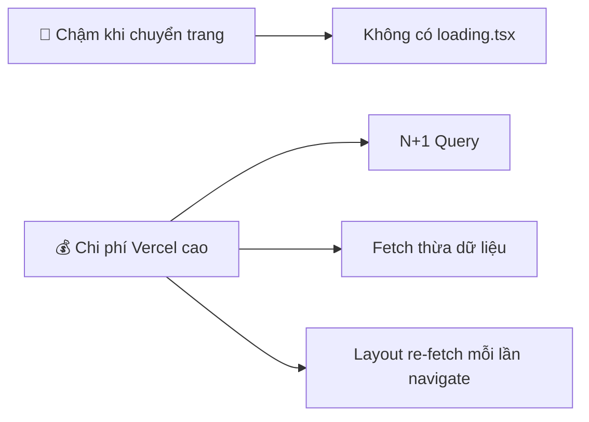

# 🚀 Web Optimization Plan

## Tình trạng hiện tại

Sau khi phân tích toàn bộ codebase, tôi xác định được **6 vấn đề chính** gây ảnh hưởng đến trải nghiệm người dùng và chi phí Vercel:



---

## Vấn đề #1: Không có `loading.tsx` — Navigation cảm giác chậm

> [!CAUTION]
> **Nghiêm trọng nhất.** Hiện tại **0 file `loading.tsx`** trong toàn bộ `/app`. Khi user click sidebar, trang phải fetch xong 100% data rồi mới render → user thấy "đơ" 1-3 giây.

**Giải pháp:** Tạo `loading.tsx` cho mỗi route group chính. Next.js sẽ hiển thị skeleton ngay lập tức khi navigate, trang data sẽ stream vào sau.

### Files cần tạo

| File (NEW) | Mô tả |
|---|---|
| `app/(dashboard)/loading.tsx` | Skeleton cho toàn bộ dashboard |
| `app/student/loading.tsx` | Skeleton cho student pages |
| `app/student/classes/loading.tsx` | Skeleton cho trang classes |
| `app/student/history/loading.tsx` | Skeleton cho trang lịch sử |
| `app/(dashboard)/teacher/classes/[id]/loading.tsx` | Skeleton cho trang chi tiết lớp |
| `app/(dashboard)/teacher/classes/[id]/assignments/[assignmentId]/loading.tsx` | Skeleton cho assignment editor |
| `app/(dashboard)/teacher/grading/loading.tsx` | Skeleton cho trang chấm bài |
| `app/(dashboard)/teacher/students/loading.tsx` | Skeleton cho trang quản lý học viên |
| `app/learn/[classId]/assignments/[assignmentId]/loading.tsx` | Skeleton cho quiz runner |

---

## Vấn đề #2: Student Layout chạy heavy query MỖI LẦN chuyển trang

> [!WARNING]
> [student/layout.tsx](file:///d:/Project%20Code%20Kiem%20Tien/Online%20Study%20Platform%20tieng%20anh/app/student/layout.tsx) gọi `getStudentDashboardData()` trên **mỗi lần navigate** giữa các trang student (`/student`, `/student/classes`, `/student/history`). Hàm này thực hiện **3 Prisma queries** lớn (enrollments + progress + submissions).

**Chi phí:** Mỗi lần student click sidebar = 3 DB queries + server-side render. Nhân với N students = chi phí function invocations cao.

**Giải pháp:**
- Chuyển progress count trong sidebar thành client-side fetch (hoặc cache giữa các navigations)
- Hoặc dùng `unstable_cache` từ Next.js để cache kết quả trong 60 giây

```diff
// student/layout.tsx
- const data = await getStudentDashboardData();
+ // Option A: Remove heavy fetch from layout, use a lightweight count query
+ const counts = await prisma.assignmentProgress.count({
+   where: { userId: session.user.id, status: "COMPLETED" }
+ });
```

---

## Vấn đề #3: API `weekly/route.ts` có N+1 Query Problem

> [!WARNING]
> [weekly/route.ts](file:///d:/Project%20Code%20Kiem%20Tien/Online%20Study%20Platform%20tieng%20anh/app/api/teacher/classes/%5Bid%5D/progress/weekly/route.ts#L74-L94) chạy **1 Prisma query per student** trong vòng `Promise.all(students.map(...))`. Nếu lớp có 30 học viên → **30 DB queries** mỗi lần gọi API.

**Giải pháp:** Thay bằng 1 query duy nhất lấy tất cả progress, rồi group bằng JavaScript:

```diff
- const progressData = await Promise.all(students.map(async (member) => {
-     const userProgress = await prisma.assignmentProgress.findMany({...});
-     ...
- }));

+ // 1 query for ALL students' progress
+ const allProgress = await prisma.assignmentProgress.findMany({
+     where: {
+         assignment: { classId },
+         userId: { in: students.map(s => s.userId) }
+     },
+     include: { assignment: true }
+ });
+ // Then group by userId in JS
+ const progressByUser = new Map<string, typeof allProgress>();
```

**Impact:** Giảm từ N+1 queries → 2 queries. Tiết kiệm đáng kể Vercel function time.

---

## Vấn đề #4: Teacher Pages dùng Client-Side Fetching

> [!NOTE]
> Các trang teacher ([teacher/page.tsx](file:///d:/Project%20Code%20Kiem%20Tien/Online%20Study%20Platform%20tieng%20anh/app/(dashboard)/teacher/page.tsx), [grading/page.tsx](file:///d:/Project%20Code%20Kiem%20Tien/Online%20Study%20Platform%20tieng%20anh/app/(dashboard)/teacher/grading/page.tsx), [students/page.tsx](file:///d:/Project%20Code%20Kiem%20Tien/Online%20Study%20Platform%20tieng%20anh/app/(dashboard)/teacher/students/page.tsx)) đều là `"use client"` + `useEffect` fetch. Điều này gây **double round-trip**: Browser → Server (page) → Browser → Server (API) → Browser.

**Giải pháp:** Không cần thay đổi ngay (vì đã có loading state riêng). Nhưng **nếu muốn tối ưu thêm**, có thể chuyển sang Server Component + pass data qua props (như `teacher/classes/page.tsx` đã làm đúng).

**Ưu tiên:** Thấp — chỉ cần thêm `loading.tsx` là đủ cải thiện UX đáng kể.

---

## Vấn đề #5: Student History Page fetch quá nhiều data

> [!NOTE]
> [student/history/page.tsx](file:///d:/Project%20Code%20Kiem%20Tien/Online%20Study%20Platform%20tieng%20anh/app/student/history/page.tsx#L40-L60) include **toàn bộ questions + class** cho mỗi assignment chỉ để hiển thị icon type và tên lớp. Dữ liệu question content rất nặng (JSON chứa passage, images, options).

**Giải pháp:**

```diff
  include: {
      assignment: {
          include: {
-             class: true,
-             questions: true
+             class: { select: { id: true, title: true } },
+             questions: { select: { type: true, points: true } }
          }
      },
  }
```

**Impact:** Giảm 80-90% data transfer từ DB.

---

## Vấn đề #6: `student/classes/page.tsx` gọi lại `getStudentDashboardData()`

> [!NOTE]
> [student/classes/page.tsx](file:///d:/Project%20Code%20Kiem%20Tien/Online%20Study%20Platform%20tieng%20anh/app/student/classes/page.tsx) import và gọi `getStudentDashboardData()` — hàm nặng 3 queries — chỉ để lấy danh sách classes. Nên có query riêng nhẹ hơn.

**Giải pháp:** Tạo hàm `getStudentClasses()` riêng, chỉ fetch enrollments + progress count.

---

## Thứ tự ưu tiên triển khai

| # | Việc | Impact | Effort |
|---|---|---|---|
| 1 | Tạo `loading.tsx` cho tất cả routes | ⭐⭐⭐⭐⭐ UX | Thấp |
| 2 | Fix N+1 query trong `weekly/route.ts` | ⭐⭐⭐⭐ Chi phí | Trung bình |
| 3 | Tối ưu Student Layout (bỏ heavy fetch) | ⭐⭐⭐⭐ Chi phí + UX | Trung bình |
| 4 | Select chỉ fields cần thiết trong History | ⭐⭐⭐ Chi phí | Thấp |
| 5 | Tách `getStudentClasses()` | ⭐⭐ Chi phí | Thấp |
| 6 | Chuyển Teacher pages sang Server Component | ⭐⭐ UX | Cao |

## Verification Plan

### Automated
- `npm run build` sau mỗi thay đổi
- Test navigation giữa các trang, xem skeleton có hiện không

### Manual
- Đo thời gian perceived load (bấm sidebar → thấy content) trước/sau optimization
- Monitor Vercel function invocations trước/sau
